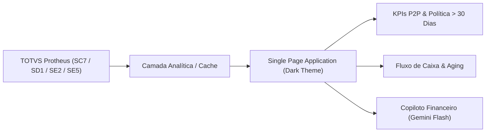

# 📊 Portal de Inteligência Financeira, Auditoria P2P & Copiloto IA (TOTVS Protheus)


-F59E0B?style=for-the-badge)


> **English Summary:** Corporate executive portal for financial intelligence, Procure-to-Pay (P2P) cycle auditing, supplier payment policy compliance (>30 days), and cash flow monitoring integrated with TOTVS Protheus ERP and Google Gemini AI Assistant. Clean single-page application built with modern Dark Theme, Chart.js, and simulated local demo data.

---

## 🔒 Nota de Segurança e Conformidade (LGPD)
> **Aviso de Compliance:** Este repositório é uma versão de demonstração para portfólio profissional. Todos os dados comerciais, razões sociais, números de pedidos, CNPJs, valores financeiros e chaves de API foram **100% anonimizados** e substituídos por dados sintéticos (`mock_data.js`). A identidade visual fictícia adotada é **AgroTech Bioenergia S.A.** sob a assinatura técnica **VB Systems | RPA & Analytics**.

---

## 1. O Problema de Negócio
Em grandes operações agroindustriais, a gestão do ciclo de compras a pagamento (**Procure-to-Pay — P2P**) enfrenta desafios recorrentes:
* **Descumprimento de Política de Prazos:** Compras negociadas com prazos de pagamento curtos (< 30 dias) afetam diretamente o capital de giro e o fluxo de caixa.
* **Falta de Visibilidade em Tempo Real:** Relatórios de ERP transacionais são engessados e geram retrabalho manual para consolidação de KPIs executivos.
* **Gargalos Operacionais entre Setores:** Atrasos na liberação de alçadas (`SCR`), emissão de notas fiscais (`SD1`) e registro de títulos (`SE2`) geram retenções indesejadas.

### A Solução
O **Portal P2P & Inteligência Financeira** resolve essa dor ao centralizar indicadores operacionais, auditoria de fornecedores, previsibilidade de caixa e um **Copiloto Financeiro com Inteligência Artificial (Google Gemini)** em uma interface moderna, rápida e responsiva em **Dark Theme**.

---

## 2. Arquitetura e Principais Funcionalidades



* **Dashboard Executivo Dark Theme:** Desenvolvido em Tailwind CSS com tipografia refinada, cartões com efeito de profundidade e contraste otimizado para operações contínuas.
* **Auditoria de Fornecedores e Prazos:** Gráficos interativos (Chart.js) de cumprimento de política de pagamento, Pareto por categoria e ranking de fornecedores.
* **Copiloto Financeiro com IA:** Assistente virtual integrado que responde a consultas analíticas sobre os dados da tela (com modo simulado nativo e suporte a chave de API real do Google AI Studio).
* **Filtros Dinâmicos Multi-Unidade:** Segmentação imediata por operação (`Unidade Polo Litoral - ES`, `Unidade Polo Interior - SP`, `Unidade Corporativa - São Paulo - SP`).

---

## 3. Estrutura do Repositório
```text
01-portal-p2p-indicadores-financeiros/
├── index.html          # Aplicação Web SPA completa (Dark Theme)
├── mock_data.js        # Camada de dados sintéticos realistas de P2P / Protheus
├── .env.example        # Modelo de variáveis de ambiente
├── .gitignore          # Filtro de arquivos sensíveis e pesados
└── README.md           # Documentação técnica de portfólio
```

---

## 4. Como Executar Localmente
Este projeto foi construído para funcionar com zero atrito, sem necessidade de servidores complexos ou banco de dados externo:

1. Clone o repositório:
   ```bash
   git clone https://github.com/<seu-usuario>/portal-p2p-indicadores-financeiros.git
   cd portal-p2p-indicadores-financeiros
   ```
2. Abra o arquivo `index.html` diretamente no seu navegador:
   - No Windows, dê dois cliques em `index.html` ou execute no PowerShell:
     ```powershell
     Start-Process index.html
     ```
   - Ou utilize qualquer servidor HTTP local:
     ```bash
     npx serve . -l 3000
     ```
3. Na tela de login, utilize as credenciais de demonstração pré-preenchidas:
   * **E-mail:** `demo.gestor@agrotechbioenergia.com.br`
   * **Senha:** `demo123`

---

## 👨‍💻 Autor e Assinatura Técnica
Desenvolvido por **Victor Beraldo** | **VB Systems — RPA & Analytics**
